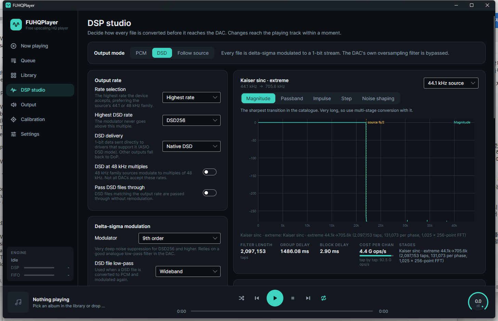

# FUPlayer

**Free Upscaling Player**

An audio player that resamples with very long FIR filters and can modulate everything to DSD,
so your DAC's own oversampling filter and modulator never run.
Now with Neural Restorer and Upscaler.

FUPlayer plays your music through a configurable resampler, optional neural processing and PCM or DSD output.
Choose a filter in DSP studio, inspect its response, and see the active processing chain in Now playing.
Whether a DAC bypasses its internal processing depends on the device and its selected mode.

## Download and first run

1. Download **FUPlayer-0.6.2-win-x64.zip** from the [latest release](https://github.com/jerrybeomsoo/FUPlayer/releases/latest).
2. Extract the whole ZIP to a writable folder. Start **FUPlayer.exe** inside it.
3. On **Output**, choose your audio back-end and device. Start with a PCM rate your DAC supports.
4. Add music folders in **Library**, or open files and add them to the queue.
5. In **DSP studio**, start with an automatic filter length. Enable additional processing one stage at a time.

The player requires **64-bit Windows 10 or 11**. The ZIP includes the .NET runtime and both neural models;
no separate .NET installation is needed. ASIO needs your device's driver. GPU processing needs a working GPU driver.
Keep the files and the `models` folder beside the executables when moving the installation.
Settings and the library cache are stored separately in `%APPDATA%\FUPlayer` and survive an upgrade.
Close the old player before replacing it; extracting a new release into a new folder also works.

FLAC, WAV, AIFF, DSF and DFF have built-in readers. MP3, AAC/ALAC, Ogg, Opus and other formats need the
optional FFmpeg libraries. Install them using **Settings → FFmpeg**; see the [FFmpeg guide](docs/building-ffmpeg.md).
Those libraries are built separately and are not included in the ZIP.

## What you can use

- **PCM and DSD output:** WASAPI exclusive/shared or ASIO, including native DSD where the driver supports it.
- **DSP studio:** long FIR filters, the Transient-Aligned Filter, phase choices, response plots and delay information.
- **GPU resampling:** automatic CUDA preference on NVIDIA, Vulkan on other GPUs, with OpenCL available for manual selection.
- **Neural restorer and upscaler:** optional processing for supported source formats, with separate Windows GPU choices.
- **Network DSP:** send resampling, the restorer, the upscaler, or any combination to another computer on your LAN or over the Internet.
- **Library and Tracks:** album grouping from tags, track search, embedded/named cover art and file ratings.
- **Monitoring:** spectrum/spectrogram, output delta, DSP load, underruns and network round trip time.
- **Other inputs:** application audio capture on Windows and a UPnP renderer controlled by another application.

## Network processing

The processing computer needs only the matching **FUPlayer-DspServer** executable, available separately for
Windows x64 and Linux x64. It does not need the player, CLI, an audio device or a .NET installation.
Linux users can install it as a boot service using the downloadable **install-dsp-server.sh**.
The server releases its active workers when playback stops or pauses.

Start with the [network setup guide](docs/network-dsp.md), then enable **Settings → Network DSP** and choose
the stages to process remotely. Client and server should both be v0.6.2. Internet servers use an access key and encrypted UDP, without TLS.
LAN-only servers can retain plain UDP. Only the listener port needs forwarding; worker ports stay on loopback.

## Guides

| You want to… | Read |
| --- | --- |
| Choose output, buffering, GPU and language settings | [Settings](docs/settings.md) |
| Choose filters and understand delay | [DSP studio](docs/dsp.md) and [Transient-Aligned Filter](docs/transient-aligned-filter.md) |
| Set up another computer for processing | [Network DSP](docs/network-dsp.md) |
| Organise albums, covers, tracks and the queue | [Library](docs/library.md) |
| Try neural processing or the exciter | [Restorer](docs/neural-restorer.md), [upscaler](docs/neural-upscaler.md), [exciter](docs/exciter.md) |
| Play from a UPnP controller | [UPnP input](docs/upnp-input.md) |
| Fix dropouts or report a problem | [Troubleshooting](docs/troubleshooting.md) |
| Render files or use the terminal | [Command line](docs/cli.md) |
| Build the software | [Building](docs/building.md) |

These guides are also in the ZIP's `docs` folder. [Changes in v0.6.2](CHANGELOG.md) include the standalone
network server, CUDA/Vulkan resampling, file preprocessing, corrected TAF graphs and safer cover selection.
v0.6.2 adds domain/URL connections and single-port Internet DSP with an access key. This is an early release; supported output rates and sustained performance depend on your hardware.

## Licence and contributions

FUPlayer and its bundled neural models use the [MIT licence](LICENSE). Dependencies retain their own
licences; see [third-party notices](THIRD-PARTY-NOTICES.md) and the included `licenses` folder.
Bug reports and contributions are welcome; see [CONTRIBUTING.md](CONTRIBUTING.md).
